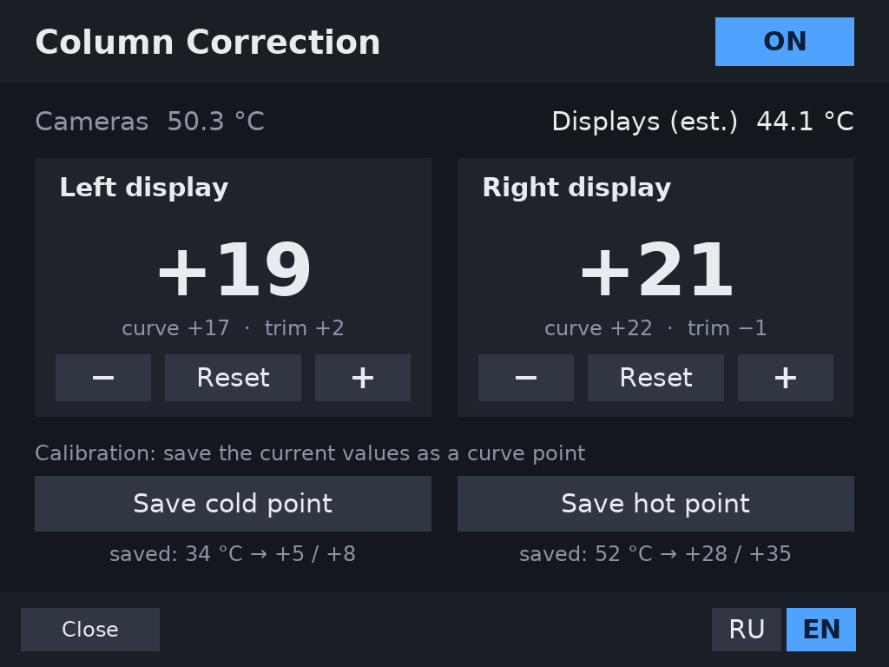
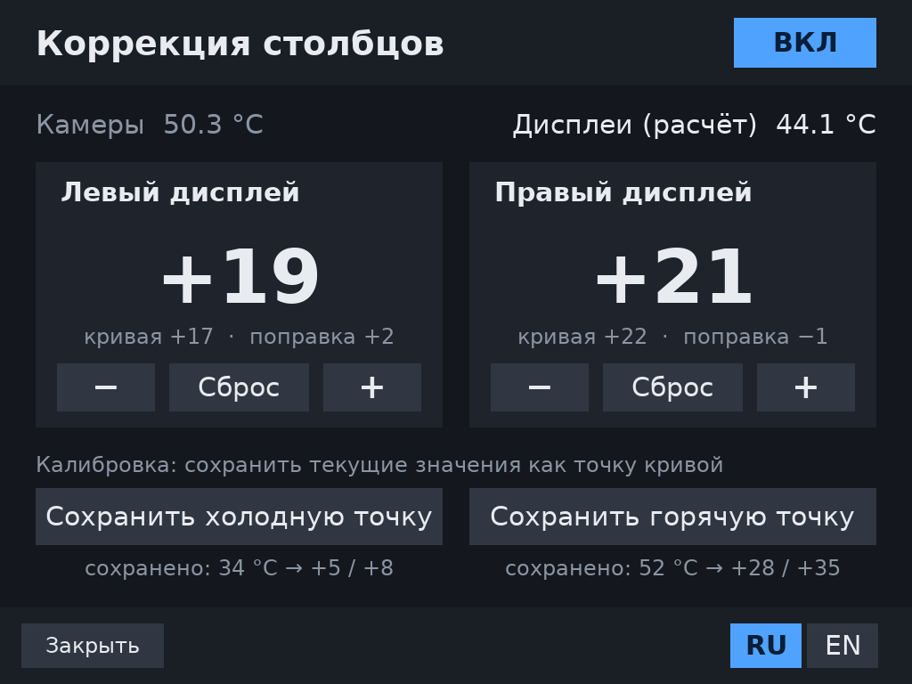

# Column Correction for the Steam Frame / Коррекция столбцов для Steam Frame

English below · Русская версия — в раскрывающемся блоке ниже

---

## English

### What it is

Some Steam Frame owners, including me, see fine vertical stripes (neighbouring pixel columns with different brightness). They are almost invisible on a cold headset and become noticeable after 15–30 minutes, especially on grey, green and blue and while turning the head. Reports on the Steam forum mention them on the left display for some units and on the right for others. How many headsets are affected is not known.

The stripes appear to be related to the **VCOM** voltage of the LCD displays: shifting it away from the factory value makes them disappear, and the shift needed grows as the displays warm up. Why the factory value does not fit is not known (calibration conditions, a calibration error or a defect are all possible). This package does roughly what the Valve Index "Column correction" setting did:

- **the `vcom-fix` service** shifts each display's VCOM relative to its own factory value and follows the headset's warm-up;
- **the "Column Correction" app** in the SteamVR dashboard turns the correction on and off, adjusts it separately for the left and right display, and calibrates it right in the headset.



### Why this project

On my headset, both displays need correction as they warm up, the right one more than the left. Other owners on the Steam forum reported that after a repair or replacement they got the same problem on the other display, in some cases worse. So instead of sending the headset in, I tried to get to the bottom of it with the help of Claude (Anthropic's AI assistant), and I am sharing the results here.

### ⚠️ Please read

- **Experimental and unofficial. Use at your own risk.** Not affiliated with Valve.
- It changes a low-level setting of the LCD displays. Running wrong values for a long time can cause **image retention** ("ghosting") and could in theory damage a display.
- Using it may affect your warranty.
- Tested on one Steam Frame (BOE displays) in November 2026, including the automatic reading of the factory values. Future SteamOS updates may change things.
- Nothing is written into the displays' memory: turning the correction off, or removing the service, and rebooting restores the factory values.

### Requirements

- A Steam Frame with **Developer Mode** on: Steam Settings → System → Enable Developer Mode. Then **set a password**: Developer → Set User Password.
- A computer on the same network with `ssh`/`scp` (built into PowerShell on Windows 10/11).

### Where to type the commands

Commands are typed in two places, and it matters which one. The start of the line tells you where you are:

| Line starts with | You are on | Commands |
|---|---|---|
| `PS C:\Users\...>` | the **computer** (PowerShell) | only `ssh` (and `scp` in option 2) |
| `[steamos@frame ~]$` | the **headset** (after `ssh`) | everything else (`curl`, `tar`, `sudo bash …`) |

If you paste a headset command into PowerShell, you get an error like "The token '&&' is not a valid statement separator". That means you are still on the computer: connect with `ssh` first.

### Install

Latest version: [frame-column-correction.tar.gz](https://github.com/ClericC/frame-column-correction/releases/latest/download/frame-column-correction.tar.gz) (all versions on the [Releases](https://github.com/ClericC/frame-column-correction/releases) page).

**Option 1 (easier): download directly on the headset.**

1. **On the computer** (PowerShell), connect to the headset:
   ```
   ssh steamos@frame
   ```
   It asks for the Developer Mode password (it is not shown while typing; that is normal). If `frame` is not found, use the headset's IP address.
2. **On the headset** (the line starts with `[steamos@frame ~]$`), download and install:
   ```
   curl -LO https://github.com/ClericC/frame-column-correction/releases/latest/download/frame-column-correction.tar.gz
   tar -xzf frame-column-correction.tar.gz && sudo bash frame-column-correction/install.sh
   ```
   It should end with `vcom-fix: active`. Type `exit` to go back to the computer.

**Option 2: via the computer** (if the headset cannot download the file itself).

1. Download `frame-column-correction.tar.gz` to your computer.
2. **On the computer** (PowerShell), copy it to the headset and connect (adjust the path):
   ```
   scp $HOME\Downloads\frame-column-correction.tar.gz steamos@frame:
   ssh steamos@frame
   ```
3. **On the headset**, install:
   ```
   tar -xzf frame-column-correction.tar.gz && sudo bash frame-column-correction/install.sh
   ```

**Then:** restart the headset (the new entry appears in the menu after a restart).

### Opening the app

1. Press the system button on a controller to open the SteamVR dashboard.
2. Click **"+"** at the bottom of the dashboard.
3. In the list of programs to launch, choose **Column Correction** (shown as "Коррекция столбцов" when SteamVR is in Russian).

The app opens inside the dashboard. The correction itself is done by the service and keeps working when the app is closed: you only need the app to switch the correction on or off, adjust it or calibrate it. **Close** ends the app; open it again the same way.

After installing, the correction is **off** and all values are 0. Calibrate it for your headset first.

### Calibration (once)

1. **Cold point.** Right after switching on a cold headset, open the app (see above) and press **ON**. Look at a flat grey or green surface and turn your head slowly. Use "−" / "+" to find the value without stripes for each display (close the other eye while checking one). Then press **"Save cold point"**, and press again to confirm.
2. **Hot point.** Play for 1–2 hours, until "Displays (est.)" stops rising noticeably. Find the values again and press **"Save hot point"**.
3. Done. Between the two points the service follows the temperature by itself.

If stripes show up at some stage of the warm-up later, adjust with "−/+" (a temporary trim on top of the curve). If you keep needing a trim, save the point again.

Tips:
- **"Inverted" stripes** mean too much correction.
- **If stripes appear midway through the warm-up,** tune `LAG_MIN` in the settings file: how slowly the displays follow the camera temperature, in minutes (default 22). Lower it if the correction lags behind, raise it if it runs ahead.

### How the temperature tracking works

- **The displays have no temperature sensor of their own.** The service uses the average of the **camera** sensors (`camera0`, `camera1`). They sit at the front next to the displays and, unlike the CPU and GPU, do not jump around with the game load.
- **The cameras warm up faster than the displays**, so the service does not use their temperature directly. It keeps a smoothed **display temperature estimate** that follows the cameras with a delay of `LAG_MIN` minutes (22 by default). The app shows it as "Displays (est.)".
- **The VCOM offset** moves smoothly between the cold and the hot point according to this estimate. Below the cold point its value is used, above the hot point the hot value.
- **When the headset is taken off and goes to sleep,** the displays and cameras cool down, and the estimate gradually follows.
- **So after a break** (headset off for a while), stripes may show up briefly: the estimate does not match the real display temperature yet. If the calibration is right, they disappear by themselves within a few minutes as the temperatures settle. If they stay, adjust a calibration point or `LAG_MIN`.
- The estimate survives a service restart and is reset only when the headset reboots.

### Safety checks

- Once a week, check for image retention: look at a still, high-contrast image for 5–10 minutes, then at a flat grey background, one eye at a time. If an outline stays longer than a few seconds, turn the correction off.
- The service never goes beyond −10 … +45 steps from the factory value.
- If the service cannot read the displays' factory values, it **changes nothing** and shows an error in the app.
- After very long sessions (many hours) the displays may temporarily need more correction. A break is the better fix, not higher values.

### Files and commands

| What | Where |
|---|---|
| Settings | `/home/steamos/vcom-fix/vcom.conf` |
| Current state | `cat /run/vcom-fix.state` |
| App log | `journalctl --user -u frame-vcom` |
| Service log | `sudo journalctl -u vcom-fix` |

**Update:** connect to the headset (`ssh steamos@frame`) and **on the headset** run (or bring the archive over from the computer as in option 2):
```
sudo rm -rf frame-column-correction frame-column-correction.tar.gz
curl -LO https://github.com/ClericC/frame-column-correction/releases/latest/download/frame-column-correction.tar.gz
tar -xzf frame-column-correction.tar.gz && sudo bash frame-column-correction/install.sh
```
Your settings are kept. If you are working as root (the line starts with `[root@frame …]#`), go to the right folder first: `cd /home/steamos`.

**Remove the app:** `bash ~/.local/lib/frame-vcom/uninstall.sh`.

**Remove the service:** `sudo systemctl disable --now vcom-fix && sudo rm -r /etc/vcom-fix /etc/systemd/system/vcom-fix.service`, then reboot.

**After a major SteamOS update,** check `systemctl is-active vcom-fix` and reinstall if it is gone.

---

<details>
<summary><b>Русский (нажмите, чтобы раскрыть)</b></summary>

### Что это

У некоторых владельцев Steam Frame, в том числе у меня, видны тонкие вертикальные полосы (соседние столбцы пикселей светятся с разной яркостью). Они почти не видны на холодном шлеме и становятся заметнее через 15–30 минут игры, особенно на серых, зелёных и синих тонах и при поворотах головы. По сообщениям на форуме Steam, у одних полосы на левом дисплее, у других на правом. Сколько шлемов затронуто, неизвестно.

Полосы, судя по всему, связаны с напряжением **VCOM** LCD-дисплеев: если сдвинуть его от заводского значения, полосы пропадают, а нужный сдвиг растёт по мере прогрева дисплеев. Почему заводское значение не подходит, неизвестно: возможны условия калибровки на заводе, ошибка калибровки или брак. Этот набор делает примерно то же, что настройка «Коррекция столбцов» для Valve Index:

- **служба `vcom-fix`** сдвигает VCOM каждого дисплея относительно его собственного заводского значения и плавно меняет сдвиг по мере прогрева;
- **приложение «Коррекция столбцов»** в дашборде SteamVR позволяет включать и выключать коррекцию, подстраивать её отдельно для левого и правого дисплея и калибровать прямо в шлеме.



### Почему появился этот проект

На моём шлеме коррекция при нагреве нужна обоим дисплеям, правому больше, чем левому. Другие владельцы на форуме Steam писали, что после ремонта или замены получили ту же проблему на другом дисплее, а у некоторых она стала ещё заметнее. Поэтому вместо отправки шлема я попробовал разобраться в проблеме с помощью Claude (ИИ-ассистента от Anthropic) и делюсь результатами.

### ⚠️ Важно прочитать

- **Это экспериментальный и неофициальный инструмент. Вы используете его на свой риск.** Он не связан с Valve.
- Он меняет низкоуровневую настройку LCD-дисплеев. Долгая работа с неправильными значениями может вызвать **остаточное изображение** («призраки»), а теоретически и повреждение дисплея.
- Использование может повлиять на гарантию.
- Проверено на одном Steam Frame (дисплеи BOE) в ноябре 2026 года, в том числе автоопределение заводских значений. Будущие обновления SteamOS могут всё изменить.
- Изменения не записываются в память дисплеев. Если выключить коррекцию или удалить службу и перезагрузиться, вернутся заводские значения.

### Что нужно

- Steam Frame с включённым **режимом разработчика**: Steam Settings → System → Enable Developer Mode. Затем **задать пароль**: Developer → Set User Password.
- Компьютер в той же сети Wi-Fi с `ssh`/`scp` (на Windows 10/11 они уже есть в PowerShell).

### Где вводить команды

Команды вводятся в двух местах, и важно не перепутать. Определить, где вы, можно по началу строки:

| Начало строки | Где вы | Какие команды |
|---|---|---|
| `PS C:\Users\...>` | **компьютер** (PowerShell) | только `ssh` (и `scp` в способе 2) |
| `[steamos@frame ~]$` | **шлем** (после `ssh`) | все остальные (`curl`, `tar`, `sudo bash …`) |

Если вставить команду для шлема в PowerShell, появится ошибка вроде «Лексема "&&" не является допустимым разделителем». Значит, вы ещё на компьютере, и сначала нужно подключиться через `ssh`.

### Установка

Последняя версия: [frame-column-correction.tar.gz](https://github.com/ClericC/frame-column-correction/releases/latest/download/frame-column-correction.tar.gz) (все версии — на странице [Releases](https://github.com/ClericC/frame-column-correction/releases)).

**Способ 1 (проще): скачать прямо на шлем.**

1. **На компьютере** (PowerShell) подключитесь к шлему:
   ```
   ssh steamos@frame
   ```
   Команда спросит пароль режима разработчика (при вводе он не отображается, это нормально). Если имя `frame` не находится, используйте IP-адрес шлема.
2. **На шлеме** (строка начинается с `[steamos@frame ~]$`) скачайте и установите:
   ```
   curl -LO https://github.com/ClericC/frame-column-correction/releases/latest/download/frame-column-correction.tar.gz
   tar -xzf frame-column-correction.tar.gz && sudo bash frame-column-correction/install.sh
   ```
   В конце должно появиться `vcom-fix: active`. Выйти со шлема обратно на компьютер можно командой `exit`.

**Способ 2: через компьютер** (если шлем не может скачать файл сам).

1. Скачайте `frame-column-correction.tar.gz` на компьютер.
2. **На компьютере** (PowerShell) скопируйте его на шлем и подключитесь (путь поправьте под себя):
   ```
   scp $HOME\Downloads\frame-column-correction.tar.gz steamos@frame:
   ssh steamos@frame
   ```
3. **На шлеме** установите:
   ```
   tar -xzf frame-column-correction.tar.gz && sudo bash frame-column-correction/install.sh
   ```

**Затем:** перезагрузите шлем (новый пункт появляется в меню после перезагрузки).

### Как открыть приложение

1. Нажмите системную кнопку на контроллере, чтобы открыть дашборд SteamVR.
2. Нажмите **«+»** внизу дашборда.
3. В разделе **«Запустить программу»** выберите **«Коррекция столбцов»** (в английском интерфейсе SteamVR — «Column Correction»).

Приложение откроется прямо в дашборде. Саму коррекцию выполняет служба, и она продолжает работать, когда приложение закрыто: приложение нужно только чтобы включить или выключить коррекцию, подстроить или откалибровать её. Кнопка **«Закрыть»** завершает приложение, открыть его снова можно тем же способом.

После установки коррекция **выключена**, а все значения равны 0. Сначала её нужно откалибровать под ваш шлем.

### Калибровка (один раз)

1. **Холодная точка.** Сразу после включения холодного шлема откройте приложение (см. выше) и нажмите **ВКЛ**. Смотрите на ровную серую или зелёную поверхность и медленно поворачивайте голову. Кнопками «−» / «+» подберите для каждого дисплея значение, при котором полос нет (проверяя дисплей, закрывайте другой глаз). Затем нажмите **«Сохранить холодную точку»** и ещё раз для подтверждения.
2. **Горячая точка.** Поиграйте 1–2 часа, пока «Дисплеи (расчёт)» не перестанут заметно расти. Снова подберите значения и нажмите **«Сохранить горячую точку»**.
3. Готово. Между этими точками служба плавно меняет коррекцию по температуре сама.

Если позже полосы появятся на каком-то этапе прогрева, подкрутите «−/+» (это временная поправка поверх кривой). Если поправка нужна постоянно, сохраните точку заново.

Подсказки:
- **Полосы «в обратную сторону»** значат, что коррекции слишком много.
- **Если полосы появляются на середине прогрева,** настройте в файле параметр `LAG_MIN`: насколько медленно дисплеи догоняют температуру камер, в минутах (по умолчанию 22). Если коррекция запаздывает, уменьшите его; если опережает, увеличьте.

### Как служба следит за температурой

- **Отдельного датчика у дисплеев нет.** Служба берёт среднюю температуру датчиков **камер** (`camera0`, `camera1`). Они стоят спереди рядом с дисплеями и, в отличие от процессора и графики, не скачут вместе с нагрузкой в игре.
- **Камеры нагреваются быстрее дисплеев**, поэтому служба не использует их температуру напрямую. Она плавно ведёт **расчётную температуру дисплеев**, которая догоняет температуру камер с задержкой `LAG_MIN` минут (по умолчанию 22). В приложении это строка «Дисплеи (расчёт)».
- **Смещение VCOM** служба плавно меняет между холодной и горячей точкой по этой расчётной температуре. Ниже холодной точки действует её значение, выше горячей — значение горячей.
- **Когда шлем снят и уходит в сон,** дисплеи и камеры остывают, и расчётная температура тоже постепенно снижается.
- **Поэтому после перерыва** (шлем какое-то время был снят) полосы могут ненадолго появиться: расчёт ещё не совпадает с реальной температурой дисплеев. Если калибровка сделана правильно, через несколько минут они пропадут сами, когда температура выровняется. Если полосы держатся долго, поправьте точку калибровки или `LAG_MIN`.
- Расчётная температура сохраняется при перезапуске службы и сбрасывается только при перезагрузке шлема.

### Безопасность и проверка

- Раз в неделю проверяйте «призраки»: 5–10 минут смотрите на неподвижную контрастную картинку, потом на ровный серый фон, по очереди каждым глазом. Если контур держится дольше нескольких секунд, выключите коррекцию.
- Служба никогда не выходит за пределы от −10 до +45 шагов от заводского значения.
- Если служба не может прочитать заводские значения дисплеев, она **ничего не меняет** и показывает ошибку в приложении.
- После очень долгих сессий (много часов) дисплеям может временно требоваться больше коррекции. Лучшее средство — перерыв, а не увеличение значений.

### Файлы и команды

| Что | Где |
|---|---|
| Настройки | `/home/steamos/vcom-fix/vcom.conf` |
| Текущее состояние | `cat /run/vcom-fix.state` |
| Журнал приложения | `journalctl --user -u frame-vcom` |
| Журнал службы | `sudo journalctl -u vcom-fix` |

**Обновление.** Подключитесь к шлему (`ssh steamos@frame`) и **на шлеме** выполните (или скачайте архив через компьютер, как в способе 2):
```
sudo rm -rf frame-column-correction frame-column-correction.tar.gz
curl -LO https://github.com/ClericC/frame-column-correction/releases/latest/download/frame-column-correction.tar.gz
tar -xzf frame-column-correction.tar.gz && sudo bash frame-column-correction/install.sh
```
Ваши настройки сохранятся. Если вы работаете под root (строка начинается с `[root@frame …]#`), сначала перейдите в нужную папку: `cd /home/steamos`.

**Удаление приложения:** `bash ~/.local/lib/frame-vcom/uninstall.sh`.

**Удаление службы:** `sudo systemctl disable --now vcom-fix && sudo rm -r /etc/vcom-fix /etc/systemd/system/vcom-fix.service`, затем перезагрузка.

**После крупного обновления SteamOS** проверьте `systemctl is-active vcom-fix`. Если служба пропала, установите заново.

</details>

---

### License / Лицензия

MIT, © 2026 ClericC: see `LICENSE`. Feedback and bug reports: [Issues](https://github.com/ClericC/frame-column-correction/issues).

### Third-party / Сторонние компоненты

- OpenVR API (Valve), BSD-3-Clause: `LICENSE.openvr`
- Pre-rendered glyphs of the DejaVu fonts: `FONT-LICENSE.txt`
