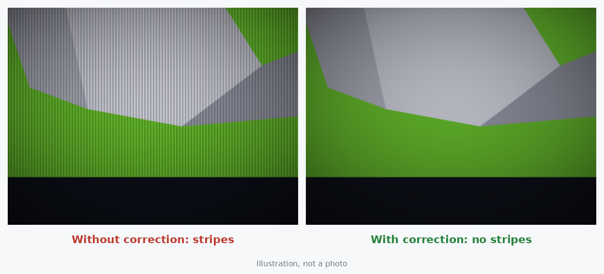
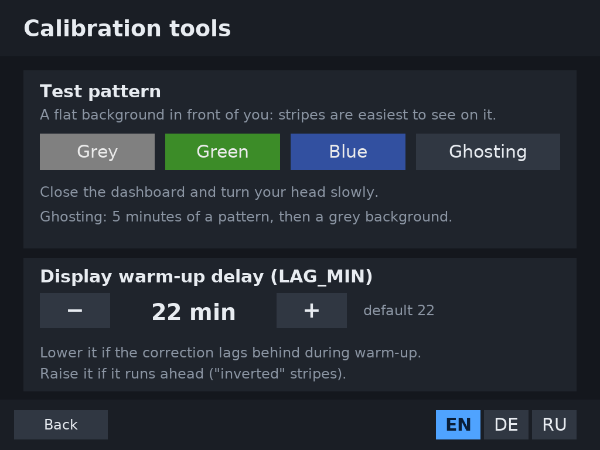
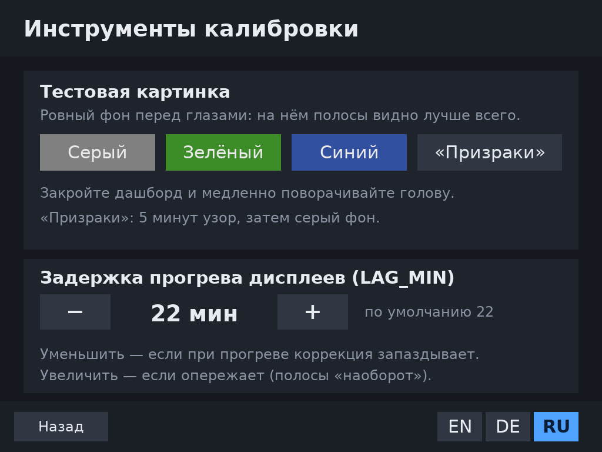
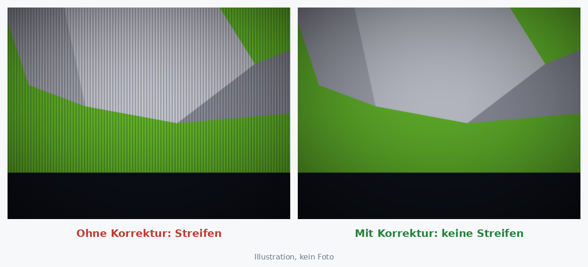
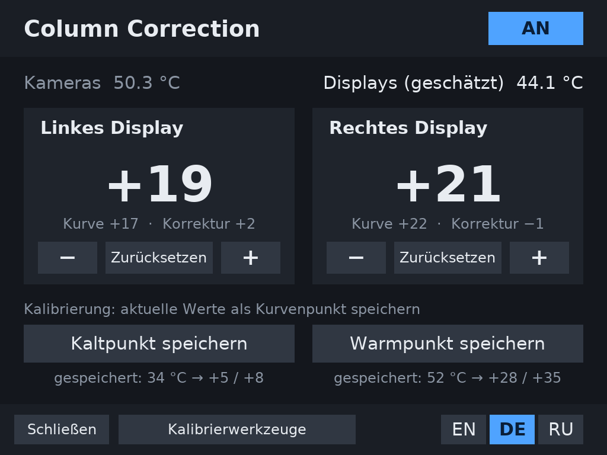
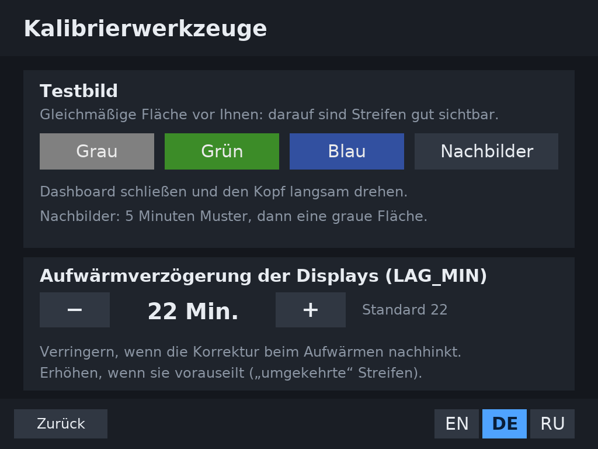

# Column Correction for the Steam Frame

Other languages are available at the bottom of the page.

---

### What it is

Some Steam Frame owners, including me, see fine vertical stripes (neighbouring pixel columns with different brightness). They are almost invisible on a cold headset and become noticeable after 15–30 minutes, especially on grey, green and blue and while turning the head. Reports on the Steam forum mention them on the left display for some units and on the right for others. How many headsets are affected is not known.



The stripes appear to be related to the **VCOM** voltage of the LCD displays: shifting it away from the factory value makes them disappear, and the shift needed grows as the displays warm up. Why the factory value does not fit is not known (calibration conditions, a calibration error or a defect are all possible). This package does roughly what the Valve Index "Column correction" setting did:

- **the `vcom-fix` service** shifts each display's VCOM relative to its own factory value and follows the headset's warm-up;
- **the "Column Correction" app** in the SteamVR dashboard turns the correction on and off, adjusts it separately for the left and right display, and calibrates it right in the headset.


### Why this project

On my headset, both displays need correction as they warm up, the right one more than the left. Other owners on the Steam forum reported that after a repair or replacement they got the same problem on the other display, in some cases worse. So instead of sending the headset in, I tried to get to the bottom of it with the help of Claude (Anthropic's AI assistant), and I am sharing the results here.

### ⚠️ Please read

- **Experimental and unofficial. Use at your own risk.** Not affiliated with Valve.
- It changes a low-level setting of the LCD displays. Running wrong values for a long time can cause **image retention** ("ghosting") and could in theory damage a display.
- Using it may affect your warranty.
- Tested on one Steam Frame (BOE displays) in November 2026, including the automatic reading of the factory values. Future SteamOS updates may change things.
- Nothing is written into the displays' memory: turning the correction off, or removing the service, and rebooting restores the factory values.

### Requirements

- A Steam Frame with **Developer Mode** on: Steam Settings → System → Enable Developer Mode. Then **set a password**: Developer → Set User Password.
- A computer on the same network with `ssh`/`scp` (built into PowerShell on Windows 10/11).

### Where to type the commands

Commands are typed in two places, and it matters which one. The start of the line tells you where you are:

| Line starts with | You are on | Commands |
|---|---|---|
| `PS C:\Users\...>` | the **computer** (PowerShell) | only `ssh` (and `scp` in option 2) |
| `[steamos@frame ~]$` | the **headset** (after `ssh`) | everything else (`curl`, `tar`, `sudo bash …`) |

If you paste a headset command into PowerShell, you get an error like "The token '&&' is not a valid statement separator". That means you are still on the computer: connect with `ssh` first.

### Install

Latest version: [frame-column-correction.tar.gz](https://github.com/ClericC/frame-column-correction/releases/latest/download/frame-column-correction.tar.gz) (all versions on the [Releases](https://github.com/ClericC/frame-column-correction/releases) page).

**Option 1 (easier): download directly on the headset.**

1. **On the computer** (PowerShell), connect to the headset:
   ```
   ssh steamos@frame
   ```
   It asks for the Developer Mode password (it is not shown while typing; that is normal). If `frame` is not found, use the headset's IP address.
2. **On the headset** (the line starts with `[steamos@frame ~]$`), download and install:
   ```
   curl -LO https://github.com/ClericC/frame-column-correction/releases/latest/download/frame-column-correction.tar.gz
   tar -xzf frame-column-correction.tar.gz && sudo bash frame-column-correction/install.sh
   ```
   It should end with `vcom-fix: active`. Type `exit` to go back to the computer.

**Option 2: via the computer** (if the headset cannot download the file itself).

1. Download `frame-column-correction.tar.gz` to your computer.
2. **On the computer** (PowerShell), copy it to the headset and connect (adjust the path):
   ```
   scp $HOME\Downloads\frame-column-correction.tar.gz steamos@frame:
   ssh steamos@frame
   ```
3. **On the headset**, install:
   ```
   tar -xzf frame-column-correction.tar.gz && sudo bash frame-column-correction/install.sh
   ```

**Then:** restart the headset (the new entry appears in the menu after a restart).

### Opening the app

1. Press the system button on a controller to open the SteamVR dashboard.
2. Click **"+"** at the bottom of the dashboard.
3. In the list of programs to launch, choose **Column Correction**.

The app opens inside the dashboard. The correction itself is done by the service and keeps working when the app is closed: you only need the app to switch the correction on or off, adjust it or calibrate it. **Close** ends the app; open it again the same way.

After installing, the correction is **off** and all values are 0. Calibrate it for your headset first.

### Calibration (once)

1. **Cold point.** Right after switching on a cold headset, open the app (see above) and press **ON**. Look at a flat grey or green surface (**Calibration tools → Grey** or **Green** puts one in front of you) and turn your head slowly. Use "−" / "+" to find the value without stripes for each display (close the other eye while checking one). Then press **"Save cold point"**, and press again to confirm.
2. **Hot point.** Play for 1–2 hours, until "Displays (est.)" stops rising noticeably. Find the values again and press **"Save hot point"**.
3. Done. Between the two points the service follows the temperature by itself.

The confirm button shows the temperature that will be saved. If you saved a point by mistake, press **Undo** next to the message (it stays for 20 seconds): the previous point and trims come back.

If stripes show up at some stage of the warm-up later, adjust with "−/+" (a temporary trim on top of the curve). If you keep needing a trim, save the point again.

Tips:
- **"Inverted" stripes** mean too much correction.
- **If stripes appear midway through the warm-up,** change the **warm-up delay** (`LAG_MIN`) in **Calibration tools**: how slowly the displays follow the camera temperature, in minutes (default 22). Lower it if the correction lags behind, raise it if it runs ahead.

### Calibration tools

The **Calibration tools** button at the bottom of the app opens a second screen:

- **Test pattern: Grey, Green, Blue.** A large flat background, fixed in the room about 2 m in front of you. Close the dashboard and turn your head slowly: stripes are easiest to see this way. **Remove pattern** takes it away (it also disappears when the app is closed).
- **Ghosting.** A high-contrast checkerboard that moves with your head for 5 minutes, then a grey background with a question: close one eye, then the other. If an outline stays longer than a few seconds, see *Safety checks*.
- **Display warm-up delay (`LAG_MIN`)**, 5–60 minutes, see *How the temperature tracking works*.



### How the temperature tracking works

- **The displays have no temperature sensor of their own.** The service uses the average of the **camera** sensors (`camera0`, `camera1`). They sit at the front next to the displays and, unlike the CPU and GPU, do not jump around with the game load.
- **The cameras warm up faster than the displays**, so the service does not use their temperature directly. It keeps a smoothed **display temperature estimate** that follows the cameras with a delay of `LAG_MIN` minutes (22 by default). The app shows it as "Displays (est.)".
- **The VCOM offset** moves smoothly between the cold and the hot point according to this estimate. Below the cold point its value is used, above the hot point the hot value.
- **When the headset is taken off and goes to sleep,** the displays and cameras cool down, and the estimate gradually follows.
- **So after a break** (headset off for a while), stripes may show up briefly: the estimate does not match the real display temperature yet. If the calibration is right, they disappear by themselves within a few minutes as the temperatures settle. If they stay, adjust a calibration point or `LAG_MIN`.
- The estimate survives a service restart and is reset only when the headset reboots.

### Safety checks

- Once a week, check for image retention with **Calibration tools → Ghosting** (or look at a still, high-contrast image for 5–10 minutes, then at a flat grey background, one eye at a time). If an outline stays longer than a few seconds, turn the correction off.
- The service never goes beyond −10 … +45 steps from the factory value.
- If the service cannot read the displays' factory values, it **changes nothing** and shows an error in the app.
- Before the first write, the service checks that the display driver looks as expected: the factory values it reports must match the displays' own memory. If not (for example after a SteamOS update changed the driver), it **changes nothing** and the app shows "Unknown display driver".
- After very long sessions (many hours) the displays may temporarily need more correction. A break is the better fix, not higher values.

### FAQ

**PowerShell says "The token '&&' is not a valid statement separator".** The command is meant for the headset, but you are still on the computer. Connect first with `ssh steamos@frame` (see *Where to type the commands*).

**"Permission denied" when updating.** Files from the previous version belong to root. Remove them with `sudo rm -rf …` as shown under *Update*.

**Column Correction is not in the "+" menu.** Restart the headset after installing. If it is still missing, check that `~/.local/share/applications/frame-vcom.desktop` exists, or install again.

**The app says "Service vcom-fix is not responding".** Check `systemctl is-active vcom-fix` and the log `sudo journalctl -u vcom-fix`. After a major SteamOS update the service may be gone: install again.

**The app says "Cannot read the displays' factory values" or "Unknown display driver".** The correction is paused and nothing is written to the displays, so it is safe. Please open an [issue](https://github.com/ClericC/frame-column-correction/issues) with the output of `cat /run/vcom-fix.state`.

**Stripes come back for a few minutes after a break.** Expected: the temperature estimate needs time to catch up (see *How the temperature tracking works*).

**Do I need to calibrate for each refresh rate?** The service uses the displays' own factory value for each refresh rate and re-applies the correction within about 2 seconds after a switch; the same offsets are added for all rates. So far this has been tested at 90 Hz. If another rate needs different values on your headset, please report it.

**Can I share my values?** Yes, that helps: open an issue with your display type, cold and hot values and refresh rate. Values are individual, so do not copy someone else's without checking.

### Files and commands

| What | Where |
|---|---|
| Settings | `/home/steamos/vcom-fix/vcom.conf` |
| Current state | `cat /run/vcom-fix.state` |
| App log | `journalctl --user -u frame-vcom` |
| Service log | `sudo journalctl -u vcom-fix` |

**Update:** connect to the headset (`ssh steamos@frame`) and **on the headset** run (or bring the archive over from the computer as in option 2):
```
sudo rm -rf frame-column-correction frame-column-correction.tar.gz
curl -LO https://github.com/ClericC/frame-column-correction/releases/latest/download/frame-column-correction.tar.gz
tar -xzf frame-column-correction.tar.gz && sudo bash frame-column-correction/install.sh
```
Your settings are kept. If you are working as root (the line starts with `[root@frame …]#`), go to the right folder first: `cd /home/steamos`.

**Remove the app:** `bash ~/.local/lib/frame-vcom/uninstall.sh`.

**Remove the service:** `sudo systemctl disable --now vcom-fix && sudo rm -r /etc/vcom-fix /etc/systemd/system/vcom-fix.service`, then reboot.

**After a major SteamOS update,** check `systemctl is-active vcom-fix` and reinstall if it is gone.

---

<details>
<summary><b>Русский (нажмите, чтобы раскрыть)</b></summary>

### Что это

У некоторых владельцев Steam Frame, в том числе у меня, видны тонкие вертикальные полосы (соседние столбцы пикселей светятся с разной яркостью). Они почти не видны на холодном шлеме и становятся заметнее через 15–30 минут игры, особенно на серых, зелёных и синих тонах и при поворотах головы. По сообщениям на форуме Steam, у одних полосы на левом дисплее, у других на правом. Сколько шлемов затронуто, неизвестно.


Полосы, судя по всему, связаны с напряжением **VCOM** LCD-дисплеев: если сдвинуть его от заводского значения, полосы пропадают, а нужный сдвиг растёт по мере прогрева дисплеев. Почему заводское значение не подходит, неизвестно: возможны условия калибровки на заводе, ошибка калибровки или брак. Этот набор делает примерно то же, что настройка «Коррекция столбцов» для Valve Index:

- **служба `vcom-fix`** сдвигает VCOM каждого дисплея относительно его собственного заводского значения и плавно меняет сдвиг по мере прогрева;
- **приложение «Коррекция столбцов»** в дашборде SteamVR позволяет включать и выключать коррекцию, подстраивать её отдельно для левого и правого дисплея и калибровать прямо в шлеме.


### Почему появился этот проект

На моём шлеме коррекция при нагреве нужна обоим дисплеям, правому больше, чем левому. Другие владельцы на форуме Steam писали, что после ремонта или замены получили ту же проблему на другом дисплее, а у некоторых она стала ещё заметнее. Поэтому вместо отправки шлема я попробовал разобраться в проблеме с помощью Claude (ИИ-ассистента от Anthropic) и делюсь результатами.

### ⚠️ Важно прочитать

- **Это экспериментальный и неофициальный инструмент. Вы используете его на свой риск.** Он не связан с Valve.
- Он меняет низкоуровневую настройку LCD-дисплеев. Долгая работа с неправильными значениями может вызвать **остаточное изображение** («призраки»), а теоретически и повреждение дисплея.
- Использование может повлиять на гарантию.
- Проверено на одном Steam Frame (дисплеи BOE) в ноябре 2026 года, в том числе автоопределение заводских значений. Будущие обновления SteamOS могут всё изменить.
- Изменения не записываются в память дисплеев. Если выключить коррекцию или удалить службу и перезагрузиться, вернутся заводские значения.

### Что нужно

- Steam Frame с включённым **режимом разработчика**: Steam Settings → System → Enable Developer Mode. Затем **задать пароль**: Developer → Set User Password.
- Компьютер в той же сети Wi-Fi с `ssh`/`scp` (на Windows 10/11 они уже есть в PowerShell).

### Где вводить команды

Команды вводятся в двух местах, и важно не перепутать. Определить, где вы, можно по началу строки:

| Начало строки | Где вы | Какие команды |
|---|---|---|
| `PS C:\Users\...>` | **компьютер** (PowerShell) | только `ssh` (и `scp` в способе 2) |
| `[steamos@frame ~]$` | **шлем** (после `ssh`) | все остальные (`curl`, `tar`, `sudo bash …`) |

Если вставить команду для шлема в PowerShell, появится ошибка вроде «Лексема "&&" не является допустимым разделителем». Значит, вы ещё на компьютере, и сначала нужно подключиться через `ssh`.

### Установка

Последняя версия: [frame-column-correction.tar.gz](https://github.com/ClericC/frame-column-correction/releases/latest/download/frame-column-correction.tar.gz) (все версии — на странице [Releases](https://github.com/ClericC/frame-column-correction/releases)).

**Способ 1 (проще): скачать прямо на шлем.**

1. **На компьютере** (PowerShell) подключитесь к шлему:
   ```
   ssh steamos@frame
   ```
   Команда спросит пароль режима разработчика (при вводе он не отображается, это нормально). Если имя `frame` не находится, используйте IP-адрес шлема.
2. **На шлеме** (строка начинается с `[steamos@frame ~]$`) скачайте и установите:
   ```
   curl -LO https://github.com/ClericC/frame-column-correction/releases/latest/download/frame-column-correction.tar.gz
   tar -xzf frame-column-correction.tar.gz && sudo bash frame-column-correction/install.sh
   ```
   В конце должно появиться `vcom-fix: active`. Выйти со шлема обратно на компьютер можно командой `exit`.

**Способ 2: через компьютер** (если шлем не может скачать файл сам).

1. Скачайте `frame-column-correction.tar.gz` на компьютер.
2. **На компьютере** (PowerShell) скопируйте его на шлем и подключитесь (путь поправьте под себя):
   ```
   scp $HOME\Downloads\frame-column-correction.tar.gz steamos@frame:
   ssh steamos@frame
   ```
3. **На шлеме** установите:
   ```
   tar -xzf frame-column-correction.tar.gz && sudo bash frame-column-correction/install.sh
   ```

**Затем:** перезагрузите шлем (новый пункт появляется в меню после перезагрузки).

### Как открыть приложение

1. Нажмите системную кнопку на контроллере, чтобы открыть дашборд SteamVR.
2. Нажмите **«+»** внизу дашборда.
3. В разделе **«Запустить программу»** выберите **«Коррекция столбцов»** (в английском интерфейсе SteamVR — «Column Correction»).

Приложение откроется прямо в дашборде. Саму коррекцию выполняет служба, и она продолжает работать, когда приложение закрыто: приложение нужно только чтобы включить или выключить коррекцию, подстроить или откалибровать её. Кнопка **«Закрыть»** завершает приложение, открыть его снова можно тем же способом.

После установки коррекция **выключена**, а все значения равны 0. Сначала её нужно откалибровать под ваш шлем.

### Калибровка (один раз)

1. **Холодная точка.** Сразу после включения холодного шлема откройте приложение (см. выше) и нажмите **ВКЛ**. Смотрите на ровную серую или зелёную поверхность (её можно включить: **Инструменты калибровки → Серый** или **Зелёный**) и медленно поворачивайте голову. Кнопками «−» / «+» подберите для каждого дисплея значение, при котором полос нет (проверяя дисплей, закрывайте другой глаз). Затем нажмите **«Сохранить холодную точку»** и ещё раз для подтверждения.
2. **Горячая точка.** Поиграйте 1–2 часа, пока «Дисплеи (расчёт)» не перестанут заметно расти. Снова подберите значения и нажмите **«Сохранить горячую точку»**.
3. Готово. Между этими точками служба плавно меняет коррекцию по температуре сама.

Кнопка подтверждения показывает температуру, которая будет сохранена. Если точка сохранена по ошибке, нажмите **«Отменить»** рядом с сообщением (кнопка видна 20 секунд): вернутся прежняя точка и поправки.

Если позже полосы появятся на каком-то этапе прогрева, подкрутите «−/+» (это временная поправка поверх кривой). Если поправка нужна постоянно, сохраните точку заново.

Подсказки:
- **Полосы «в обратную сторону»** значат, что коррекции слишком много.
- **Если полосы появляются на середине прогрева,** измените **задержку прогрева** (`LAG_MIN`) в **«Инструментах калибровки»**: насколько медленно дисплеи догоняют температуру камер, в минутах (по умолчанию 22). Если коррекция запаздывает, уменьшите её; если опережает, увеличьте.

### Инструменты калибровки

Кнопка **«Инструменты калибровки»** внизу приложения открывает второй экран:

- **Тестовая картинка: серый, зелёный, синий.** Большой ровный фон, закреплённый в комнате примерно в 2 м перед вами. Закройте дашборд и медленно поворачивайте голову: так полосы видно лучше всего. Кнопка **«Убрать картинку»** убирает её (она исчезает и при закрытии приложения).
- **«Призраки».** Контрастная шахматная доска, которая 5 минут движется вместе с головой, затем серый фон с вопросом: закройте один глаз, потом другой. Если контур держится дольше нескольких секунд, см. «Безопасность и проверка».
- **Задержка прогрева дисплеев (`LAG_MIN`)**, от 5 до 60 минут, см. «Как служба следит за температурой».



### Как служба следит за температурой

- **Отдельного датчика у дисплеев нет.** Служба берёт среднюю температуру датчиков **камер** (`camera0`, `camera1`). Они стоят спереди рядом с дисплеями и, в отличие от процессора и графики, не скачут вместе с нагрузкой в игре.
- **Камеры нагреваются быстрее дисплеев**, поэтому служба не использует их температуру напрямую. Она плавно ведёт **расчётную температуру дисплеев**, которая догоняет температуру камер с задержкой `LAG_MIN` минут (по умолчанию 22). В приложении это строка «Дисплеи (расчёт)».
- **Смещение VCOM** служба плавно меняет между холодной и горячей точкой по этой расчётной температуре. Ниже холодной точки действует её значение, выше горячей — значение горячей.
- **Когда шлем снят и уходит в сон,** дисплеи и камеры остывают, и расчётная температура тоже постепенно снижается.
- **Поэтому после перерыва** (шлем какое-то время был снят) полосы могут ненадолго появиться: расчёт ещё не совпадает с реальной температурой дисплеев. Если калибровка сделана правильно, через несколько минут они пропадут сами, когда температура выровняется. Если полосы держатся долго, поправьте точку калибровки или `LAG_MIN`.
- Расчётная температура сохраняется при перезапуске службы и сбрасывается только при перезагрузке шлема.

### Безопасность и проверка

- Раз в неделю проверяйте «призраки» через **«Инструменты калибровки» → «Призраки»** (или 5–10 минут смотрите на неподвижную контрастную картинку, потом на ровный серый фон, по очереди каждым глазом). Если контур держится дольше нескольких секунд, выключите коррекцию.
- Служба никогда не выходит за пределы от −10 до +45 шагов от заводского значения.
- Если служба не может прочитать заводские значения дисплеев, она **ничего не меняет** и показывает ошибку в приложении.
- Перед первой записью служба проверяет, что драйвер дисплеев выглядит как ожидается: заводские значения, которые он сообщает, должны совпадать с памятью самих дисплеев. Если нет (например, обновление SteamOS изменило драйвер), служба **ничего не меняет**, а приложение показывает «Неизвестный драйвер дисплеев».
- После очень долгих сессий (много часов) дисплеям может временно требоваться больше коррекции. Лучшее средство — перерыв, а не увеличение значений.

### Частые вопросы

**PowerShell пишет «Лексема "&&" не является допустимым разделителем».** Команда предназначена для шлема, а вы ещё на компьютере. Сначала подключитесь: `ssh steamos@frame` (см. «Где вводить команды»).

**«Permission denied» при обновлении.** Файлы прошлой версии принадлежат root. Удалите их через `sudo rm -rf …`, как в разделе «Обновление».

**В меню «+» нет «Коррекции столбцов».** Перезагрузите шлем после установки. Если пункта всё ещё нет, проверьте, что есть файл `~/.local/share/applications/frame-vcom.desktop`, или установите заново.

**Приложение пишет «Служба vcom-fix не отвечает».** Проверьте `systemctl is-active vcom-fix` и журнал `sudo journalctl -u vcom-fix`. После крупного обновления SteamOS служба может пропасть: установите заново.

**Приложение пишет «Не удалось прочитать заводские значения дисплеев» или «Неизвестный драйвер дисплеев».** Коррекция приостановлена, и на дисплеи ничего не записывается, так что это безопасно. Пожалуйста, создайте [issue](https://github.com/ClericC/frame-column-correction/issues) с выводом `cat /run/vcom-fix.state`.

**После перерыва полосы на несколько минут возвращаются.** Так и должно быть: расчётной температуре нужно время, чтобы догнать реальную (см. «Как служба следит за температурой»).

**Нужно ли калибровать для каждой частоты обновления?** Служба берёт собственное заводское значение дисплеев для каждой частоты и примерно через 2 секунды после переключения применяет коррекцию заново; одинаковые смещения добавляются для всех частот. Пока это проверено на 90 Гц. Если на вашем шлеме другой частоте нужны другие значения, сообщите, пожалуйста.

**Можно ли поделиться своими значениями?** Да, это поможет: создайте issue с типом дисплеев, холодными и горячими значениями и частотой. Значения индивидуальны, поэтому чужие без проверки не копируйте.

### Файлы и команды

| Что | Где |
|---|---|
| Настройки | `/home/steamos/vcom-fix/vcom.conf` |
| Текущее состояние | `cat /run/vcom-fix.state` |
| Журнал приложения | `journalctl --user -u frame-vcom` |
| Журнал службы | `sudo journalctl -u vcom-fix` |

**Обновление.** Подключитесь к шлему (`ssh steamos@frame`) и **на шлеме** выполните (или скачайте архив через компьютер, как в способе 2):
```
sudo rm -rf frame-column-correction frame-column-correction.tar.gz
curl -LO https://github.com/ClericC/frame-column-correction/releases/latest/download/frame-column-correction.tar.gz
tar -xzf frame-column-correction.tar.gz && sudo bash frame-column-correction/install.sh
```
Ваши настройки сохранятся. Если вы работаете под root (строка начинается с `[root@frame …]#`), сначала перейдите в нужную папку: `cd /home/steamos`.

**Удаление приложения:** `bash ~/.local/lib/frame-vcom/uninstall.sh`.

**Удаление службы:** `sudo systemctl disable --now vcom-fix && sudo rm -r /etc/vcom-fix /etc/systemd/system/vcom-fix.service`, затем перезагрузка.

**После крупного обновления SteamOS** проверьте `systemctl is-active vcom-fix`. Если служба пропала, установите заново.

</details>

---

<details>
<summary><b>Deutsch (zum Aufklappen klicken)</b></summary>

### Worum es geht

Bei einigen Steam-Frame-Besitzern, auch bei mir, sind feine senkrechte Streifen zu sehen (benachbarte Pixelspalten unterschiedlich hell). Auf einem kalten Headset sind sie kaum sichtbar und werden nach 15–30 Minuten deutlicher, vor allem auf grauen, grünen und blauen Flächen und bei Kopfbewegungen. Laut Berichten im Steam-Forum betrifft es bei manchen Geräten das linke, bei anderen das rechte Display. Wie viele Headsets betroffen sind, ist nicht bekannt.



Die Streifen hängen offenbar mit der **VCOM**-Spannung der LCD-Displays zusammen: Verschiebt man sie gegenüber dem Werkswert, verschwinden die Streifen, und die nötige Verschiebung wächst, wenn sich die Displays erwärmen. Warum der Werkswert nicht passt, ist nicht bekannt (Kalibrierbedingungen, ein Kalibrierfehler oder ein Defekt sind möglich). Dieses Paket macht ungefähr das, was die Einstellung „Column correction“ bei der Valve Index tat:

- **der Dienst `vcom-fix`** verschiebt VCOM jedes Displays relativ zu dessen eigenem Werkswert und folgt der Erwärmung des Headsets;
- **die App „Column Correction“** im SteamVR-Dashboard schaltet die Korrektur ein und aus, stellt sie für das linke und rechte Display getrennt ein und kalibriert sie direkt im Headset. Die App gibt es auf Deutsch, Englisch und Russisch; ihr Name bleibt „Column Correction“.



### Warum dieses Projekt

Bei meinem Headset brauchen beide Displays beim Erwärmen eine Korrektur, das rechte mehr als das linke. Andere Besitzer berichteten im Steam-Forum, dass sie nach einer Reparatur oder einem Austausch dasselbe Problem auf dem anderen Display hatten, teils sogar stärker. Deshalb habe ich das Headset nicht eingeschickt, sondern versucht, dem Problem mit Hilfe von Claude (dem KI-Assistenten von Anthropic) auf den Grund zu gehen, und teile hier die Ergebnisse.

### ⚠️ Bitte lesen

- **Experimentell und inoffiziell. Nutzung auf eigene Gefahr.** Keine Verbindung zu Valve.
- Es ändert eine tiefliegende Einstellung der LCD-Displays. Falsche Werte über längere Zeit können **Einbrennen / Nachbilder** („Ghosting“) verursachen und ein Display theoretisch beschädigen.
- Die Nutzung kann die Garantie beeinflussen.
- Getestet an einem Steam Frame (BOE-Displays) im November 2026, einschließlich des automatischen Auslesens der Werkswerte. Künftige SteamOS-Updates können etwas ändern.
- Nichts wird in den Speicher der Displays geschrieben: Korrektur ausschalten oder den Dienst entfernen und neu starten stellt die Werkswerte wieder her.

### Voraussetzungen

- Ein Steam Frame mit eingeschaltetem **Entwicklermodus**: Steam Settings → System → Enable Developer Mode. Danach **ein Passwort setzen**: Developer → Set User Password.
- Ein Computer im selben Netzwerk mit `ssh`/`scp` (unter Windows 10/11 in PowerShell bereits enthalten).

### Wo die Befehle eingegeben werden

Befehle werden an zwei Stellen eingegeben, und es ist wichtig, welche. Der Zeilenanfang zeigt, wo Sie sind:

| Zeile beginnt mit | Sie sind auf | Befehle |
|---|---|---|
| `PS C:\Users\...>` | dem **Computer** (PowerShell) | nur `ssh` (und `scp` bei Variante 2) |
| `[steamos@frame ~]$` | dem **Headset** (nach `ssh`) | alles andere (`curl`, `tar`, `sudo bash …`) |

Fügen Sie einen Headset-Befehl in PowerShell ein, erscheint eine Fehlermeldung zum Token „&&“. Dann sind Sie noch auf dem Computer: zuerst mit `ssh` verbinden.

### Installation

Neueste Version: [frame-column-correction.tar.gz](https://github.com/ClericC/frame-column-correction/releases/latest/download/frame-column-correction.tar.gz) (alle Versionen auf der Seite [Releases](https://github.com/ClericC/frame-column-correction/releases)).

**Variante 1 (einfacher): direkt auf das Headset herunterladen.**

1. **Auf dem Computer** (PowerShell) mit dem Headset verbinden:
   ```
   ssh steamos@frame
   ```
   Es wird das Passwort des Entwicklermodus abgefragt (es wird beim Tippen nicht angezeigt, das ist normal). Wird `frame` nicht gefunden, die IP-Adresse des Headsets verwenden.
2. **Auf dem Headset** (Zeile beginnt mit `[steamos@frame ~]$`) herunterladen und installieren:
   ```
   curl -LO https://github.com/ClericC/frame-column-correction/releases/latest/download/frame-column-correction.tar.gz
   tar -xzf frame-column-correction.tar.gz && sudo bash frame-column-correction/install.sh
   ```
   Am Ende sollte `vcom-fix: active` erscheinen. Mit `exit` kehren Sie zum Computer zurück.

**Variante 2: über den Computer** (falls das Headset die Datei nicht selbst herunterladen kann).

1. `frame-column-correction.tar.gz` auf den Computer herunterladen.
2. **Auf dem Computer** (PowerShell) auf das Headset kopieren und verbinden (Pfad anpassen):
   ```
   scp $HOME\Downloads\frame-column-correction.tar.gz steamos@frame:
   ssh steamos@frame
   ```
3. **Auf dem Headset** installieren:
   ```
   tar -xzf frame-column-correction.tar.gz && sudo bash frame-column-correction/install.sh
   ```

**Danach:** das Headset neu starten (der neue Eintrag erscheint nach einem Neustart im Menü).

### App öffnen

1. Die Systemtaste am Controller drücken, um das SteamVR-Dashboard zu öffnen.
2. Unten im Dashboard auf **„+“** klicken.
3. In der Liste der Programme zum Starten **Column Correction** wählen.

Die App öffnet sich im Dashboard. Die Korrektur selbst übernimmt der Dienst, sie läuft auch bei geschlossener App weiter: Die App wird nur zum Ein-/Ausschalten, Nachjustieren und Kalibrieren gebraucht. **Schließen** beendet die App; geöffnet wird sie auf dieselbe Weise.

Nach der Installation ist die Korrektur **aus** und alle Werte sind 0. Zuerst für das eigene Headset kalibrieren.

### Kalibrierung (einmalig)

1. **Kaltpunkt.** Direkt nach dem Einschalten eines kalten Headsets die App öffnen und **AN** drücken. Auf eine gleichmäßige graue oder grüne Fläche schauen (**Kalibrierwerkzeuge → Grau** oder **Grün** stellt eine vor Sie) und den Kopf langsam drehen. Mit „−“ / „+“ für jedes Display den Wert ohne Streifen finden (dabei das andere Auge schließen). Dann **„Kaltpunkt speichern“** drücken und zur Bestätigung noch einmal.
2. **Warmpunkt.** 1–2 Stunden spielen, bis „Displays (geschätzt)“ nicht mehr deutlich steigt. Die Werte erneut finden und **„Warmpunkt speichern“** drücken.
3. Fertig. Zwischen beiden Punkten folgt der Dienst der Temperatur selbstständig.

Die Bestätigungstaste zeigt die Temperatur, die gespeichert wird. Wurde ein Punkt versehentlich gespeichert, **„Rückgängig“** neben der Meldung drücken (die Taste bleibt 20 Sekunden sichtbar): Der vorherige Punkt und die Korrekturen kommen zurück.

Tauchen später in einer Phase der Erwärmung Streifen auf, mit „−/+“ nachjustieren (eine vorübergehende Korrektur über der Kurve). Wird sie dauerhaft gebraucht, den Punkt neu speichern.

Tipps:
- **„Umgekehrte“ Streifen** bedeuten zu viel Korrektur.
- **Erscheinen Streifen mitten in der Erwärmung,** die **Aufwärmverzögerung** (`LAG_MIN`) in den **Kalibrierwerkzeugen** anpassen: wie langsam die Displays der Kameratemperatur folgen, in Minuten (Standard 22). Verringern, wenn die Korrektur hinterherhinkt, erhöhen, wenn sie vorauseilt.

### Kalibrierwerkzeuge

Die Taste **„Kalibrierwerkzeuge“** unten in der App öffnet eine zweite Seite:

- **Testbild: Grau, Grün, Blau.** Eine große gleichmäßige Fläche, im Raum etwa 2 m vor Ihnen fixiert. Dashboard schließen und den Kopf langsam drehen: So sind Streifen am besten zu sehen. **„Testbild entfernen“** nimmt es weg (es verschwindet auch beim Schließen der App).
- **Nachbilder.** Ein kontrastreiches Schachbrett, das sich 5 Minuten mit dem Kopf bewegt, danach eine graue Fläche mit einer Frage: ein Auge schließen, dann das andere. Bleibt ein Umriss länger als einige Sekunden, siehe *Sicherheitsprüfungen*.
- **Aufwärmverzögerung der Displays (`LAG_MIN`)**, 5–60 Minuten, siehe *So funktioniert die Temperaturverfolgung*.



### So funktioniert die Temperaturverfolgung

- **Die Displays haben keinen eigenen Temperatursensor.** Der Dienst nutzt den Mittelwert der **Kamera**-Sensoren (`camera0`, `camera1`). Sie sitzen vorne neben den Displays und springen, anders als CPU und GPU, nicht mit der Spiellast.
- **Die Kameras erwärmen sich schneller als die Displays**, deshalb nutzt der Dienst ihre Temperatur nicht direkt. Er führt eine geglättete **geschätzte Displaytemperatur**, die den Kameras mit einer Verzögerung von `LAG_MIN` Minuten folgt (Standard 22). Die App zeigt sie als „Displays (geschätzt)“.
- **Die VCOM-Verschiebung** bewegt sich anhand dieser Schätzung gleitend zwischen kaltem und warmem Punkt. Unterhalb des kalten Punkts gilt dessen Wert, oberhalb des warmen Punkts der warme Wert.
- **Wird das Headset abgesetzt und geht in den Ruhezustand,** kühlen Displays und Kameras ab, und die Schätzung folgt allmählich.
- **Nach einer Pause** (Headset eine Weile abgesetzt) können daher kurz Streifen auftauchen: Die Schätzung passt noch nicht zur tatsächlichen Displaytemperatur. Bei richtiger Kalibrierung verschwinden sie nach einigen Minuten von selbst. Bleiben sie, einen Kalibrierpunkt oder `LAG_MIN` anpassen.
- Die Schätzung übersteht einen Neustart des Dienstes und wird nur beim Neustart des Headsets zurückgesetzt.

### Sicherheitsprüfungen

- Einmal pro Woche mit **Kalibrierwerkzeuge → Nachbilder** prüfen (oder 5–10 Minuten auf ein unbewegtes, kontrastreiches Bild schauen, dann auf eine gleichmäßige graue Fläche, jeweils mit einem Auge). Bleibt ein Umriss länger als einige Sekunden, die Korrektur ausschalten.
- Der Dienst geht nie über −10 … +45 Schritte vom Werkswert hinaus.
- Kann der Dienst die Werkswerte der Displays nicht lesen, **ändert er nichts** und zeigt einen Fehler in der App.
- Vor dem ersten Schreiben prüft der Dienst, ob der Displaytreiber wie erwartet aussieht: Die Werkswerte, die er meldet, müssen mit dem Speicher der Displays übereinstimmen. Wenn nicht (etwa weil ein SteamOS-Update den Treiber geändert hat), **ändert er nichts**, und die App zeigt „Unbekannter Displaytreiber“.
- Nach sehr langen Sitzungen (viele Stunden) brauchen die Displays vorübergehend eventuell mehr Korrektur. Eine Pause hilft besser als höhere Werte.

### Häufige Fragen

**PowerShell meldet einen Fehler zum Token „&&“.** Der Befehl ist für das Headset gedacht, Sie sind aber noch auf dem Computer. Zuerst verbinden: `ssh steamos@frame` (siehe *Wo die Befehle eingegeben werden*).

**„Permission denied“ beim Aktualisieren.** Die Dateien der vorherigen Version gehören root. Mit `sudo rm -rf …` entfernen, wie unter *Aktualisieren* gezeigt.

**Column Correction fehlt im „+“-Menü.** Das Headset nach der Installation neu starten. Fehlt der Eintrag weiterhin, prüfen, ob `~/.local/share/applications/frame-vcom.desktop` existiert, oder neu installieren.

**Die App meldet „Dienst vcom-fix antwortet nicht“.** `systemctl is-active vcom-fix` und das Protokoll `sudo journalctl -u vcom-fix` prüfen. Nach einem größeren SteamOS-Update kann der Dienst fehlen: neu installieren.

**Die App meldet „Werkswerte der Displays nicht lesbar“ oder „Unbekannter Displaytreiber“.** Die Korrektur ist pausiert, und auf die Displays wird nichts geschrieben, das ist also sicher. Bitte ein [Issue](https://github.com/ClericC/frame-column-correction/issues) mit der Ausgabe von `cat /run/vcom-fix.state` erstellen.

**Nach einer Pause kommen die Streifen für einige Minuten zurück.** Das ist zu erwarten: Die Temperaturschätzung braucht Zeit, um aufzuholen (siehe *So funktioniert die Temperaturverfolgung*).

**Muss ich für jede Bildwiederholrate kalibrieren?** Der Dienst nutzt für jede Rate den eigenen Werkswert der Displays und wendet die Korrektur etwa 2 Sekunden nach einem Wechsel erneut an; für alle Raten werden dieselben Verschiebungen addiert. Bisher bei 90 Hz getestet. Braucht eine andere Rate auf Ihrem Headset andere Werte, bitte melden.

**Kann ich meine Werte teilen?** Ja, das hilft: ein Issue mit Displaytyp, kalten und warmen Werten und Bildwiederholrate erstellen. Die Werte sind individuell, also fremde nicht ungeprüft übernehmen.

### Dateien und Befehle

| Was | Wo |
|---|---|
| Einstellungen | `/home/steamos/vcom-fix/vcom.conf` |
| Aktueller Zustand | `cat /run/vcom-fix.state` |
| App-Protokoll | `journalctl --user -u frame-vcom` |
| Dienst-Protokoll | `sudo journalctl -u vcom-fix` |

**Aktualisieren:** mit dem Headset verbinden (`ssh steamos@frame`) und **auf dem Headset** ausführen (oder das Archiv wie bei Variante 2 vom Computer übertragen):
```
sudo rm -rf frame-column-correction frame-column-correction.tar.gz
curl -LO https://github.com/ClericC/frame-column-correction/releases/latest/download/frame-column-correction.tar.gz
tar -xzf frame-column-correction.tar.gz && sudo bash frame-column-correction/install.sh
```
Ihre Einstellungen bleiben erhalten. Arbeiten Sie als root (Zeile beginnt mit `[root@frame …]#`), zuerst in den richtigen Ordner wechseln: `cd /home/steamos`.

**App entfernen:** `bash ~/.local/lib/frame-vcom/uninstall.sh`.

**Dienst entfernen:** `sudo systemctl disable --now vcom-fix && sudo rm -r /etc/vcom-fix /etc/systemd/system/vcom-fix.service`, danach neu starten.

**Nach einem größeren SteamOS-Update** `systemctl is-active vcom-fix` prüfen und bei Bedarf neu installieren.

</details>

---

### License

MIT, © 2026 ClericC: see `LICENSE`. Feedback and bug reports: [Issues](https://github.com/ClericC/frame-column-correction/issues).

### Third-party

- OpenVR API (Valve), BSD-3-Clause: `LICENSE.openvr`
- Pre-rendered glyphs of the DejaVu fonts: `FONT-LICENSE.txt`

Changes between versions: [CHANGELOG.md](CHANGELOG.md).
